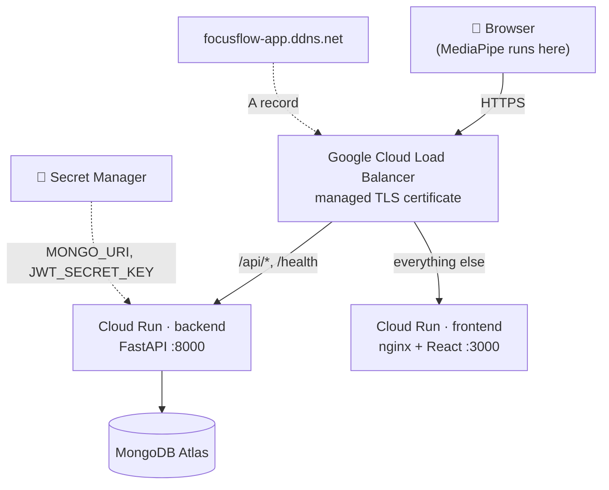

<div align="center">

# 🎯 FocusFlow

**Know when your focus slips, while you read or watch.**

FocusFlow uses your webcam to measure concentration in real time, entirely in the browser,<br>
and steps in when your attention drifts: a gentle chime, a lower volume, or a paused video.

[](https://focusflow-app.ddns.net)


</div>

---

## ✨ Features

| | |
| --- | --- |
| 📚 **Personal library** | Save articles, YouTube videos or plain text to study later. |
| 🎥 **Real-time concentration score** | A face-landmark model reads head pose, gaze, eye openness, blinks, yawns, talking and head stillness, and updates a score every second. |
| 🔔 **Smart interventions** | Attention dips → the video lowers its volume and chimes. Stays low, or you switch tabs → the video pauses until you're back. |
| 🖼️ **Anti-cheat** | A face that never blinks is probably a photo. The video pauses. |
| 📈 **Session history** | Every session is saved with its average score, duration and concentration charts. |
| 🔒 **Private by design** | The camera stream never leaves the browser. Only the numeric score is sent to the server. |

## 🧠 How the score works

```
concentration = visual attention × engagement × talking factor
```

- **Visual attention:** is the head facing the screen, is the gaze on it, are the eyes open, is the face in frame.
- **Engagement:** natural gaze movement (not a frozen stare), a healthy blink rate, no yawning, a calm head.
- **Talking factor:** sustained talking lowers the score. A short word or a laugh doesn't count.

For videos, the score is only measured while the video is playing.

| Condition | Action |
| --- | --- |
| Score below 50% for 5 s | Lower the volume and play a chime |
| Score below 25% for 15 s | Pause the video |
| Tab or window left for 5 s | Pause the video |
| Score back above 60% | Restore the volume |

## 🏗️ Architecture



- **One domain for everything.** The load balancer routes by path, so the client calls `/api` on the same origin. No CORS.
- **Stateless, horizontally scalable backend.** All state, including failed-login counters, lives in MongoDB, so any number of Cloud Run instances share the same view.
- **Locked-down services.** Cloud Run only accepts traffic from the load balancer, so the direct `run.app` URLs are closed.
- **No secrets in code or images.** They are injected from Secret Manager at runtime.

## 🛡️ Security

- Passwords hashed with **bcrypt**, with strength rules enforced server-side.
- **JWT** access tokens that can be revoked: logout blacklists the token, and a password change invalidates every older token.
- **Brute-force protection:** 5 failed logins lock the account for 15 minutes, shared across all instances.
- **No account enumeration:** a missing email takes as long to reject as a wrong password.
- Unique-email index in the database and input validation on every request.

## 🚀 Run locally

**Prerequisites:** Python 3.10+, Node 18+, Docker (for MongoDB).

```bash
# 1. Database
docker run -d --name focusflow-mongo -p 27017:27017 mongo:7

# 2. Backend
cd backend
pip install -r requirements.txt
JWT_SECRET_KEY=local-dev-secret uvicorn main:app --reload --port 8000

# 3. Frontend (new terminal)
cd frontend
npm install
npm run dev
```

Open http://localhost:3000. Vite proxies `/api` to the backend, and the camera works on `localhost` without HTTPS.

| Variable | Purpose | Default |
| --- | --- | --- |
| `MONGO_URI` | MongoDB connection string | `mongodb://localhost:27017/focusflow_db` |
| `JWT_SECRET_KEY` | Token signing key | random per process (sessions reset on restart) |

## 🧪 Tests

```bash
cd frontend && npm test
```

77 unit tests cover the scoring model, concentration signals, intervention timing, history stats and routing.

## ☁️ Deploy

Images are built with Cloud Build and stored in Artifact Registry:

```bash
gcloud builds submit backend  --region=europe-west1 --tag=europe-west1-docker.pkg.dev/PROJECT_ID/focusflow/backend:TAG
gcloud builds submit frontend --region=europe-west1 --tag=europe-west1-docker.pkg.dev/PROJECT_ID/focusflow/frontend:TAG
```

Then point the Cloud Run services at the new tag. The frontend service runs with `BACKEND_URL=none`, because in the cloud the load balancer routes `/api`, not nginx.

## 📁 Project structure

```
backend/
  main.py            FastAPI app, error handlers, DB indexes
  security.py        JWT creation and validation
  routers/           auth · content · sessions endpoints
  controllers/       request handling
  models/            MongoDB access
  schemas/           Pydantic validation
frontend/
  src/pages/         Auth · Library · Reader · History
  src/useAttentionTracker.js   camera + MediaPipe face landmarker
  src/attentionScore.js        head pose, gaze, eye and mouth signals
  src/concentration.js         engagement signals: blinks, yawns, talking
  src/interventions.js         when to chime, duck or pause
  nginx.conf         static hosting (+ /api proxy in docker compose)
```

---

<div align="center">
Built for the Power Tech 2026 Full-Stack Project · Google × Reichman University AI Tech School
</div>
